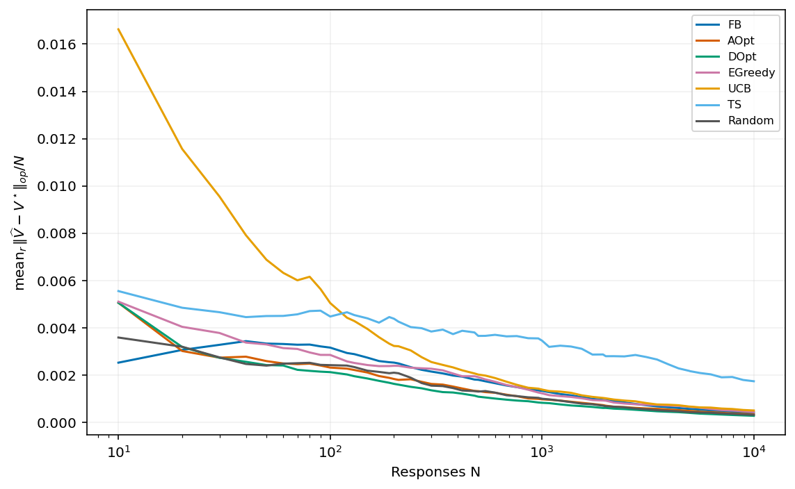
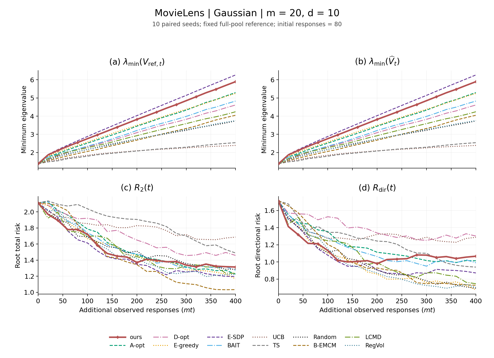

# Fisher Balancing

GLM 순차 실험에서 FisherBalancing과 실험 설계·능동 학습 기준선을 비교하는 연구 코드입니다. **코드, 설정, 테스트, 작은 예시 데이터, 대표 그림 두 장**을 담았습니다. 전체 데이터·체크포인트·실험 출력은 Git에 포함하지 않습니다.

## 빠르게 실행하기

Linux와 Python **3.12**를 권장합니다. 검증한 버전은 Python 3.12.10이며, 의존성은 Python 3.11 이상이 필요합니다. CPU만으로 아래 검증을 실행할 수 있습니다.

```bash
git clone https://github.com/Doyoung619/Fisher-Balancing.git
cd Fisher-Balancing
python3.12 -m venv .venv
source .venv/bin/activate
python -m pip install -r requirements.txt
python -m pip install torch==2.4.1 --index-url https://download.pytorch.org/whl/cpu
export OPENBLAS_NUM_THREADS=1 OMP_NUM_THREADS=1 MKL_NUM_THREADS=1
python scripts/check.py
python scripts/smoke.py --output outputs/my_first_smoke
```

마지막 명령은 새 디렉터리에 작은 합성 실험을 실행합니다. 실제 데이터를 다운로드하지 않으며, **전체 실험의 통계적 재현 결과로 해석하면 안 됩니다.** PyTorch 없이 시작하려면 설치를 생략하고 두 명령에 `--skip-sampled`를 붙이세요. 상세 실행법은 [재현 가이드](docs/REPRODUCIBILITY.md)를 참고하세요.

## 실험 구성

| 디렉터리 | 목적 | 핵심 차이 |
|---|---|---|
| [continuous_ofat](experiments/continuous_ofat/README.md) | 연속 ball의 Gaussian/Bernoulli OFAT 실험 | 연속 수치 최적화; Gaussian의 네 정보 기반 방법은 같은 경로 공유 |
| [sampled_ball](experiments/sampled_ball/README.md) | 매 배치 새 후보 cloud를 만드는 합성 실험 | 기본값은 `K=Q=4096` 전체 후보 평가; 연속 최적화와 구분 |
| [real_response](experiments/real_response/README.md) | OBD·MovieLens·Last.fm 기록 응답 실험 | 유한 pool에서 중복 없이 선택; 참 모수 대신 경험적 full-pool reference |

각 실험은 별도 패키지입니다. 특히 두 합성 실험의 패키지 이름이 모두 `src`이므로 **해당 실험 디렉터리에서 실행**합니다. 루트의 `scripts/check.py`는 이를 자동으로 분리합니다.

## 결과는 이렇게 나옵니다



기존 sampled-ball 최종 실행의 Bernoulli 중앙 조건입니다. `N=10000`, `d=10`, `m=10`, `K=Q=4096`이며, FB는 256회·기준선은 64회 반복했습니다.



기존 MovieLens 실행의 `d=10`, `m=20`, 초기 80개·추가 400개 응답, 10개 paired seed 비교입니다. 이 그림의 `ours`는 **`fb_opt2`**입니다. 기본 `server_main`의 `fb_sample`·`fb_range`와 구분해야 합니다.

두 그림은 기존 결과에서 선별한 예시입니다. [결과와 데이터 형식](docs/RESULTS.md)에 CSV 예시, 지표 정의, 원본 경로·SHA256, 재생성 방법을 정리했습니다. 코드 변경 후 새 실행이 같은 수치 결과를 보장한다는 뜻은 아닙니다.

## 개발·후속 실험

- [AGENTS.md](AGENTS.md): Codex·Claude 등 코드 에이전트가 먼저 읽을 작업 규칙과 검증 명령
- [개발 가이드](docs/DEVELOPMENT.md): 코드 구조, 새 방법 추가 위치, 과학적 불변 조건
- [재현 가이드](docs/REPRODUCIBILITY.md): 환경, smoke, 전체 실행, 중단·재개
- [출판용 정리 내역](docs/PROVENANCE.md): 원본 보존, 포함 범위, 실행 경로 변경 사항

전체 원본 데이터는 원래 GLM 작업 폴더에 보존되어 있습니다. 이 저장소는 별도로 만든 정리본이며, Git에 실험 원본 데이터를 추가할 필요가 없습니다.
