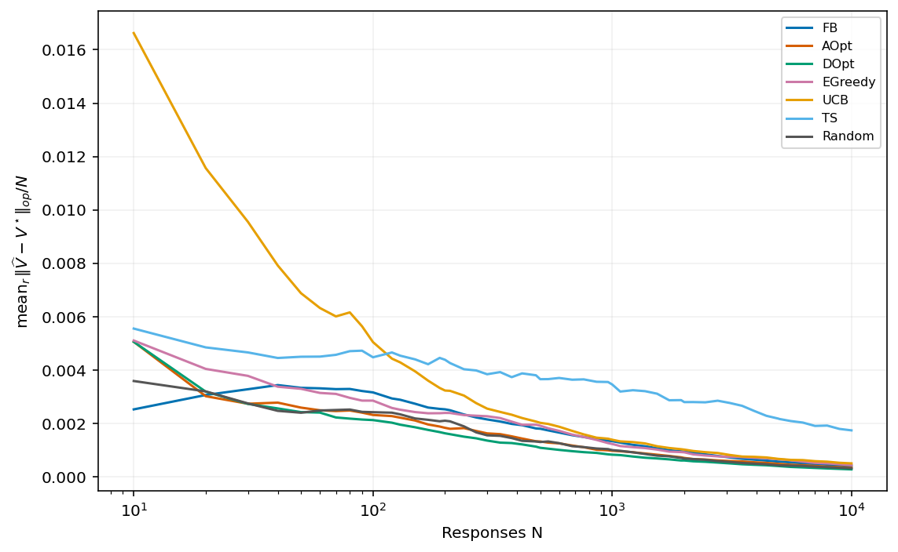
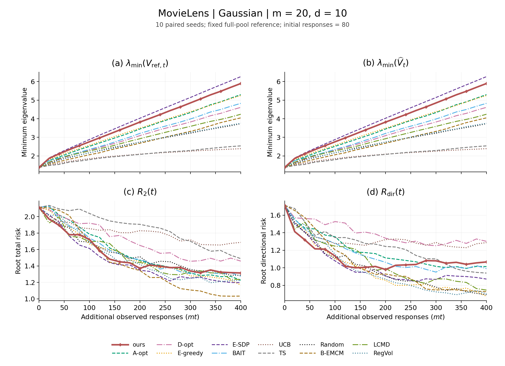

# Results and output formats

The repository contains two unmodified historical figures and small aggregate tables to show output structure. These are selected examples, not a replacement for all runs or a new statistical replication. Exact source-relative paths and hashes are in [examples/provenance.json](../examples/provenance.json).

## Included examples

| File | Content | Scope |
|---|---|---|
| [toy_pool.csv](../examples/toy_pool.csv) | 160 artificial rows, five feature columns, generated responses for three GLM families | Offline engine demonstration only; first120 pool/last40 test |
| [sampled_endpoints.csv](../examples/sampled_endpoints.csv) | Historical central-condition endpoints for both families and all seven methods | N10000, K=Q4096, d10/L1/m10; FB256 repeats, comparators64 |
| [real_movielens_curve.csv](../examples/real_movielens_curve.csv) | Exact aggregate curves used in the selected MovieLens figure | Gaussian, d10/m20, initial80 + additional400, 10 paired seeds, 12 methods |

The sampled CSV is an endpoint excerpt; it cannot reconstruct an entire historical curve or its uncertainty. The MovieLens CSV contains all checkpoints/methods needed for its one aggregate figure, but no raw rating rows, user records, selected IDs or per-seed errors.

## Reading the metrics

For signed errors `e_s` across S repetitions/seeds:

```text
Q = sum_s outer(e_s, e_s) / S          # uncentered; no dimension division
R2_squared = trace(Q)                 # mean squared parameter error
Rdir_squared = lambda_max(Q)          # eigenvalue after averaging outer products
R2 = sqrt(R2_squared)
Rdir = sqrt(Rdir_squared)
mean_l2 = mean_s norm(e_s)             # generally differs from R2
```

Synthetic errors are relative to the known generating parameter. Real `*_ref` errors are relative to the fixed full-pool ridge fit; `*_matched` errors use the prescribed budget-matched empirical reference. They do not measure an identified true-parameter error.

| Field | Definition |
|---|---|
| `N` | Synthetic response count, excluding an initial dataset (there is none) |
| `n_additional`, `n_total` | Real adaptive labels and total labels including n0 |
| `true_information`, `plugin_information` | Synthetic mean per-repeat minimum eigenvalue of Vstar/N and Vhat/N |
| `directional_ratio` | Synthetic `N * gamma_star * Rdir_squared` |
| `scaled_R2`, `R2_normalized` | Synthetic `N * R2_squared`, then divided by `trace_inv_star` |
| `tracking` | Synthetic mean `||Vhat - Vstar||op / N` |
| `mean_lambda_min_reference`, `mean_lambda_min_plugin` | Real mean per-seed minimum eigenvalues, with ridge and warm observations included |
| `actual_seed_count`, `replicates` | Actual aggregation count; inspect before comparing curves |
| `metrics_complete`, `fit_converged`, `fallback_used` | Quality/completion evidence; a completed fallback is not an SDP success |

Information eigenvalues are calculated before averaging across repetitions. Directional risk instead takes the eigenvalue after averaging outer products. Reversing that order changes the estimand. Real information values are not implicitly divided by response count; the selected synthetic tracking image explicitly is.

Bootstrap ranges are descriptive whole-response-repeat/seed resampling. With few seeds, Q has rank at most S; dimension20 with ten seeds cannot estimate a full-rank population second moment. Tied top eigenvalues further limit simple confidence-interval interpretations.

## Representative historical figures



Corrected sampled full-scan run `20261006T0031_final`, Bernoulli central condition. Y is the mean operator-norm information discrepancy divided by N. K4096 is scanned fully; the original shortlist acceleration was superseded. A full cloud scan remains an approximation to the continuous ball.



Historical family-baseline comparison, Gaussian MovieLens d10/m20, ten paired seeds. The two top panels are minimum information eigenvalues. Bottom panels are root total/directional risks to the empirical fixed reference. `ours` means **FB-opt2 (`fb_opt2`)**, not every FisherBalancing variant. Lines are recorded checkpoints without smoothing; lower risk and larger information are different objectives, and this selected image does not establish a universal ranking.

Regenerate the MovieLens figure from the included aggregate CSV without any original dataset:

```bash
python experiments/real_response/scripts/plot_paper_panels.py \
  --data examples/real_movielens_curve.csv \
  --condition gaussian_movielens_m20_d10_2x2 \
  --formats png \
  --output outputs/example_figure
```

Rendering bytes may differ with font/library versions; underlying curve values are preserved. Full synthetic figure regeneration requires the original run's per-repetition results and configuration, using its plotting CLI.

## What full runs save

Synthetic run directories contain scientific config, indexed job definitions, provenance hashes, independent references, atomic checkpoints, parameter estimates, signed errors, true/plug-in information, method diagnostics, aggregate risks, CSV tables and final/preview figures.

Real run directories contain `runs/DATASET/D/SEED/METHOD/`. Each task saves committed `checkpoints/NNN.npz` + JSON, `trajectory.csv`, theta/error arrays, selected IDs, four information matrices/spectra and batch/slot audits. Aggregation produces `aggregate/DATASET/D/METHOD/` with Q matrices, `risk_trajectory.csv`, endpoint seed bootstraps, `summary_by_condition.csv`, `plot_data/`, figures and verification reports. The required scalar columns are an explicit [schema file](../experiments/real_response/configs/required_scalar_columns.json).

All full generated artifacts stay local and ignored. The small examples do not include enough state to resume historical trajectories.
